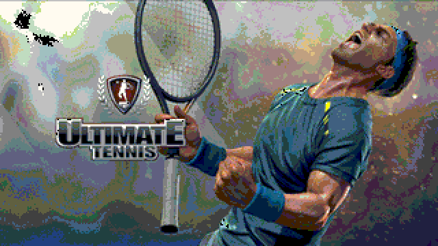
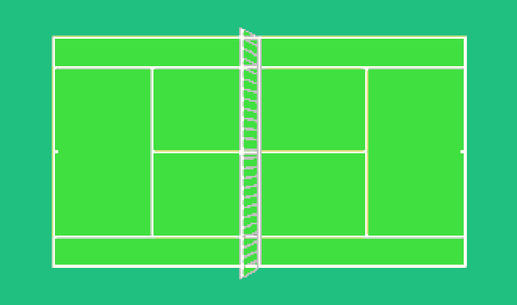
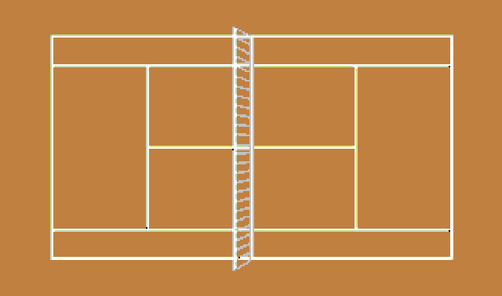
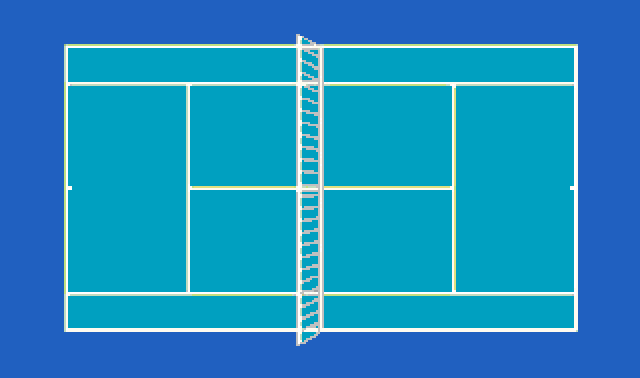
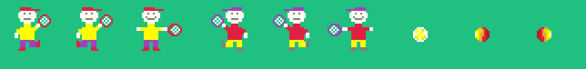
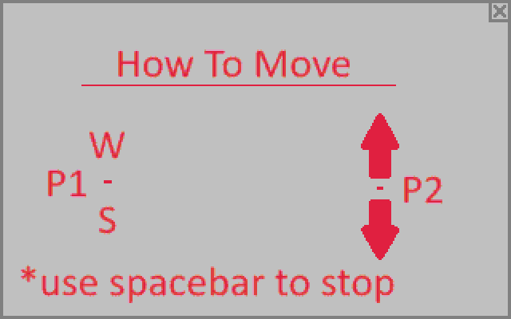
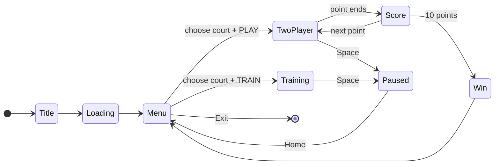
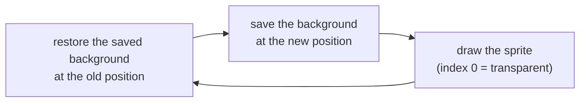

# Tennis (x86 Assembly)

A tennis game for MS-DOS, written in 16-bit x86 Assembly.


<p align="center">
  
</p>

The whole game is about 3,500 lines of assembly. It runs in 256-colour VGA, loads its graphics from BMP files at runtime, and uses the mouse for its menus.

## Features

- **2-player mode:** two players on one keyboard. The first to 10 points wins.
- **Training mode:** play against a computer opponent; the game records your longest rally.
- **Three courts:** grass, clay and hard court
- **Five ball trajectories:** straight, diagonal and half-diagonal, with a random one chosen on each return
- **Speed-ups:** on certain shots in a rally, the ball doubles its speed and changes its sprite
- **Animations:** running and swing animations for the players
- **Scoring screens:** score screens between points, and win screens at the end of a match
- **Menus:** a pause menu (resume, restart, home), a how-to-play screen and a session scoreboard

<p align="center">
  
  
  
</p>

<p align="center">
  
  <br><sub>Sprites: player 1 (running, swing), player 2 (running, swing), normal ball, fast ball (right, left)</sub>
</p>

## Controls

| Action | Player 1 (left) | Player 2 (right) |
|---|---|---|
| Move up | `W` | `↑` |
| Move down | `S` | `↓` |
| Start the point | `Enter` | `Enter` |
| Pause | `Space` | `Space` |

The menus use the mouse. In training mode, you play on the right side.

<p align="center">
  
</p>

## Game flow



## How it works

### Graphics

The game runs in VGA **mode 13h**: 320×200 pixels, 256 colours, one byte per pixel. It writes directly to video memory at segment `A000h`, and computes each pixel's offset with shifts instead of a multiplication:

```text
offset = y × 320 + x = (y << 8) + (y << 6) + x
```

### Loading BMP files

All graphics are 8-bit BMP files, loaded at runtime with DOS file functions (`INT 21h`):

1. Open the file and read the 54-byte header.
2. Read the 1,024-byte palette and load it into the VGA DAC through ports `3C8h` / `3C9h`, converting each colour to 6 bits.
3. Read the image rows from bottom to top (BMP stores them upside down), allowing for 4-byte row padding.
4. Copy each row to video memory, skipping palette index 0. That makes index 0 a transparent colour for sprites.

### Drawing sprites without flicker

Redrawing the whole court every frame would flicker. Instead, the game saves the small area of background under each sprite and restores it when the sprite moves:



The ball uses a 9×9 buffer and each player a 30×30 buffer. The court itself, a 320×160 image, is read from disk only once. After that it is kept in a 51,200-byte memory buffer and copied back to the screen when needed.

### Ball trajectories

After every hit, the ball is placed in one of three lanes, and its next trajectory is picked at random from the ones that keep it on the court:

| Lane | Possible trajectories |
|---|---|
| Top | straight, diagonal down, half-diagonal down |
| Middle | straight, half-diagonal up, half-diagonal down |
| Bottom | straight, half-diagonal up, diagonal up |

### Input, mouse and randomness

- **Keyboard:** read without blocking through BIOS `INT 16h`, so both players can move within the same game loop.
- **Mouse:** handled by an `INT 33h` driver. The game registers a `far` procedure as the left-click handler; it checks which screen is active and handles the click.
- **Computer opponent:** since each trajectory is fixed once it's chosen, the computer works out the lane where the ball will arrive and moves there.
- **Random numbers:** generated from the BIOS timer tick counter at `0040:006Ch`, combined with bytes from the program's own code.

## Running

The repository includes a prebuilt `GAME.EXE` and the Borland tools (TASM 4.1, TLINK, TD). The only thing you need to install is [DOSBox](https://www.dosbox.com/).

```text
mount c /path/to/Tennis_game_asm
c:
game
```

To build from source inside DOSBox:

```text
tasm /zi game.asm
tlink /v game.obj
game
```

- Click inside the DOSBox window to capture the mouse, and press `Ctrl+F10` to release it.
- Game speed depends on the emulated CPU speed. Adjust it in DOSBox with `Ctrl+F11` / `Ctrl+F12`.
- The game loads its `.bmp` files from the current directory, so keep them next to `GAME.EXE` with their original names.

## Project structure

```text
Tennis_game_asm/
├── game.asm       # the full game source (TASM, IDEAL mode)
├── GAME.EXE       # prebuilt executable
├── *.bmp          # 46 images: screens, courts, sprites, digits
└── TASM.EXE, TLINK.EXE, TD.EXE, RTM.EXE, DPMI16BI.OVL
```

<sub>Some of the graphics use tennis tournament imagery. This is a non-commercial school project.</sub>
